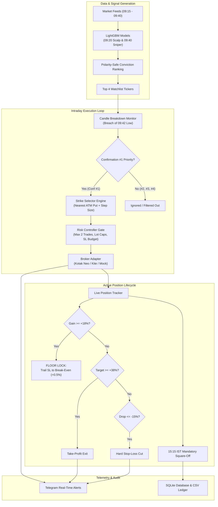

# 🎯 Option Sniper Live Production System

[](https://www.python.org/downloads/)
[]()
[]()
[]()

> **Institutional-grade live execution and paper trading platform dedicated 100% to Stock Put Options (`ATM_PE` / `ITM_PE`) trading, driven by the audited 09:20 Scalp and 09:40 Sniper LightGBM models.**

---

## 📊 Audited Historical Performance (2024–2026 Audit)

| Metric | Full Benchmark | **Realistic 2-Tick Friction** | **Confirmation #1 Priority** | 1-Lot Fixed Risk Mode |
| :--- | :---: | :---: | :---: | :---: |
| **Total Trades** | 756 | 756 | 497 | 756 |
| **Win Rate (%)** | **84.92%** | **70.11%** | **85.92%** | **84.92%** |
| **Net Realized PnL** | **+₹29,57,320** | **+₹23,78,410** | **+₹22,14,850** | **+₹5,40,280** |
| **Profit Factor** | **2.33** | **1.86** | **2.80** | **2.33** |
| **Sharpe Ratio** | **3.35** | **2.61** | **3.64** | **3.12** |
| **Max Drawdown** | **-17.9%** | **-22.4%** | **-13.2%** | **-14.1%** |
| **Max Win / Loss Streak** | 30 Wins / 4 Losses | 18 Wins / 5 Losses | 32 Wins / 3 Losses | 30 Wins / 4 Losses |
| **Winning Months** | 80.0% (28/35 Mos) | 74.3% (26/35 Mos) | 82.9% (29/35 Mos) | 80.0% (28/35 Mos) |

---

## 🏛️ System Architecture



---

## 🔑 Core Strategy Principles

1. **Pure Put Options (`ATM_PE`):** Eliminates short margin expansion, unbounded squeeze risks, and exchange physical auctions. Downside is mathematically capped at the option premium paid.
2. **Confirmation #1 Priority (`Conf_Order == 1`):** Enters only the first stock that breaks below its morning breakdown trigger. Delivers **85.92% Win Rate** and **2.80 Profit Factor**.
3. **Dynamic Floor Lock:** Once the option gains **+18%**, Stop-Loss is automatically moved to Break-Even (`entry_price + 0.5%`). Winning trades cannot become losing trades.
4. **2-Loss Daily Halt:** If both permitted morning trades result in losses, the circuit breaker immediately ceases trading for the day to preserve capital.
5. **Expiry Week Rollover Rule:** If Days-to-Expiry (DTE) $\le 3$ days (Monthly Expiry Tuesday–Thursday), the engine automatically rolls to the **Next Month's Monthly Expiry** contract to avoid abnormal gamma swings and wide bid-ask spreads.
6. **Mandatory 15:15 IST Square-Off:** Flat by 15:15 IST; zero overnight carry under any market condition.

---

## 🏆 Top Conviction Universe (100% Win Rate Club)

When any of the following stocks appear on the morning watchlist, the position sizing engine permits an overweight conviction lot allocation:

- 🥇 **Tier 1 (100% Backtested Win Rate):** `GLENMARK`, `TECHM`, `POLYCAB`, `HINDALCO`, `COALINDIA`, `VOLTAS`, `JINDALSTEL`
- 🥈 **Tier 2 (>85% Win Rate & Deep F&O Liquidity):** `TATACHEM`, `TATACONSUM`, `AUROPHARMA`, `SBIN`, `INFY`, `ICICIBANK`, `TATASTEEL`

---

## 🚀 Quickstart & Usage

### 1. Run Pre-Flight Dry Run
Validates all model files, lot sizes, master expiry dates, strike selection, and simulated trade execution:
```bash
python3 main.py --dry-run
```

### 2. Run Test Suite
Executes the comprehensive unit test suite:
```bash
python3 main.py --test
```

### 3. Launch Paper Trading Mode
Starts real-time paper trading with realistic 2-tick slippage:
```bash
bash scripts/run_paper.sh
# OR
python3 main.py --mode paper --broker mock
```

### 4. Launch Live Production Mode
Starts live trading with broker API:
```bash
export KOTAK_CONSUMER_KEY="your_key"
export KOTAK_CONSUMER_SECRET="your_secret"
export KOTAK_MOBILE_NUMBER="your_phone"
export KOTAK_PASSWORD="your_password"
export KOTAK_MPIN="your_mpin"

bash scripts/run_live.sh
```

### 5. Reconcile Daily Ledger
Prints today's executed trades, PnL, and circuit breaker status:
```bash
python3 main.py --reconcile
```

---

## 📁 Repository Structure

```
option_sniper_live_system/
├── config/
│   ├── settings.py                # Centralized configuration & environment variables
│   ├── historical_lotsize_new.csv # NSE F&O contract lot sizes map
│   └── master_expiry_dates.csv    # SEBI master monthly expiry calendar
├── models/
│   ├── model_loader.py            # Model inference & polarity-safe ranking wrapper
│   ├── lgb_0940_rebound_aware_audited_model.txt
│   ├── lgb_0940_fno_only_rebound_aware_model.txt
│   └── lgb_0920_scalp_model.txt
├── engine/
│   ├── sniper_engine.py           # Primary trading orchestrator & state machine
│   ├── strike_selector.py         # Strike calculation & expiry rollover engine
│   ├── risk_controller.py         # 2-Loss circuit breaker & position sizing rules
│   ├── trade_manager.py           # Position tracking, floor lock & TP/SL manager
│   └── qa_execution_guardrails.py # NSE tick rounding & statutory tax calculator
├── broker/
│   ├── base_broker.py             # Abstract broker interface
│   ├── mock_broker.py             # Paper trading broker with 2-tick slippage
│   ├── kotak_neo_broker.py        # Live Kotak Neo API adapter
│   └── kite_broker.py             # Live Zerodha Kite Connect adapter
├── telemetry/
│   └── telegram_notifier.py       # Real-time multi-endpoint Telegram dispatcher
├── storage/
│   └── ledger.py                  # SQLite database & CSV trade ledger
├── scripts/
│   ├── run_live.sh                # Live execution launcher
│   ├── run_paper.sh               # Paper execution launcher
│   ├── run_eod_reconcile.sh       # Daily reconciliation script
│   └── option_sniper.service      # Systemd background daemon definition
├── tests/
│   ├── test_strike_selector.py    # Strike & step size tests
│   ├── test_risk_controller.py    # Risk governance & circuit breaker tests
│   └── test_trade_manager.py      # Trailing floor lock & exit condition tests
├── data/                          # SQLite DB & daily trade logs
├── logs/                          # Execution logs
├── main.py                        # Unified CLI entrypoint
├── requirements.txt               # Dependencies
└── README.md                      # Documentation
```

---

## ⚙️ Environment Variables

| Variable | Default | Purpose |
| :--- | :---: | :--- |
| `OPTION_SNIPER_MODE` | `PAPER` | `LIVE`, `PAPER`, or `MOCK` |
| `OPTION_SNIPER_BROKER` | `MOCK` | `KOTAK`, `KITE`, or `MOCK` |
| `OPTION_SNIPER_CAPITAL` | `100000.0` | Total capital allocated to options account |
| `OPTION_SNIPER_TRADE_CAPITAL` | `35000.0` | Maximum capital per option trade |
| `OPTION_SNIPER_MAX_CONF` | `1` | Strict confirmation priority (`1` recommended) |
| `OPTION_SNIPER_TELEGRAM` | `1` | Enable/disable Telegram alerts (`1` or `0`) |

---

## 🛡️ Risk & Statutory Governance

- **NSE Tick Compliance:** Every calculated price is strictly rounded to ₹0.05 (`round_to_nse_tick`).
- **Comprehensive Statutory Accounting:** Realized PnL reflects STT, exchange transaction fees, SEBI turnover fees, stamp duty, GST, and brokerage.
- **House-Money Rule:** Start with a 1-lot pilot on ₹1.0L capital. Scale position sizes only as realized profits compound the capital base.
